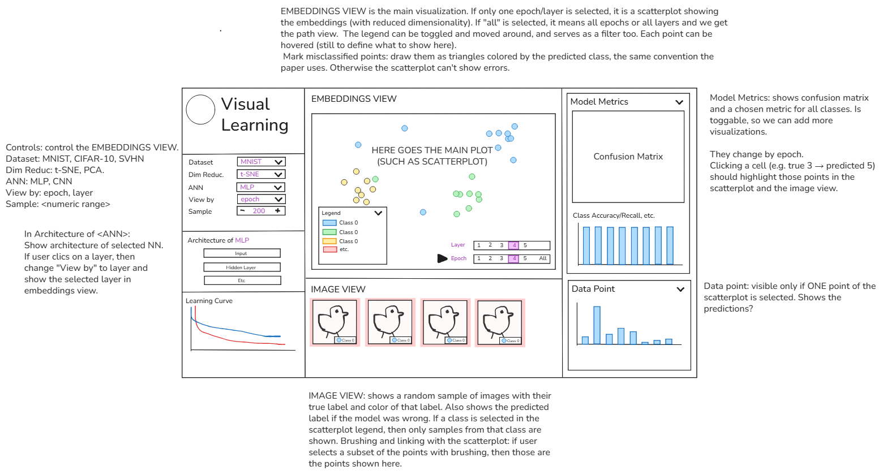

# Visual Learning — Visualization Design Plan

Design specification of the D3 front end (Phase 6–7 of `PLAN.md`). It turns the mockup
[`drafts/draft-v2.png`](drafts/draft-v2.png) plus the review feedback into a complete spec.
**Scope: design only.** Data production, file formats and rendering technology are decided in `PLAN.md`;
everything this design *needs* from the data is collected in §11 so the code agent can check feasibility.



Priority tags used below: **[M]** must (needed for the grading criteria) · **[S]** should · **[C]** could (only if time allows).

---

## 1. Purpose, audience, message

- **Audience:** classmates and instructor during a live in-class demo (projector, ~1920×1080, viewed from a
  distance), plus the grader opening the site (GitHub Pages link) alone. Assumed to know what a neural network is, not to know t-SNE.
- **Message:** *"A network learns by gradually pulling same-class observations together — over epochs (T1)
  and, inside a trained network, layer after layer (T2). Where classes stay mixed, the model makes its mistakes."*
- **Tasks (assignment):**
  - **T1 – inter-epoch:** how do the projected representations of one layer change across training epochs?
  - **T2 – inter-layer:** how do the projected representations change from the input to the output, at a given epoch?
- **Questions the user should be able to answer:**
  1. When (which epoch) do clusters appear? Which classes separate first / last? *(T1)*
  2. Which layer separates classes best? Does an untrained network already separate anything? *(T2)*
  3. Which classes get confused, and where in the projection does that happen? *(both)*
  4. Which individual observations are hard, and what do they look like? *(both)*
  5. How do MNIST → SVHN → CIFAR-10 and MLP vs CNN differ? *(both)*

---

## 2. Layout

Three columns, same structure as draft-v2. Additions to the draft are marked ★.

```
┌───────────────────┬──────────────────────────────────────────────────┬─────────────────────┐
│ ◯ Visual Learning │ EMBEDDINGS VIEW                     [Pan|Brush] ⟲│ MODEL METRICS     ▾ │
│───────────────────│ ┌──────────────────────────────────────────────┐ │ Confusion matrix    │
│ Dataset   [MNIST▾]│ │                                  ★NH 0.94    │ │ (at current epoch)  │
│ Dim. red. [t-SNE▾]│ │      scatterplot  ⇄  trail (path) view       │ │ [ ] hide diagonal   │
│ ANN       [MLP  ▾]│ │                                  ★Acc 98.4%  │ │                     │
│ View by   [epoch▾]│ │ ┌Legend ▾┐                                   │ │ Per-class [Recall▾] │
│ Sample    [-500+] │ │ │■ 0 ... │                                   │ │ ▮▮▮▮▮▮▮▮▮▮ (class   │
│ ★Color by [class▾]│ │ └────────┘                                   │ │  colors, ghost=final│
│ ★Bundling [med ▾] │ └──────────────────────────────────────────────┘ │                     │
│───────────────────│  Layer  [Input][h1][h2][h3][h4][Output]          │─────────────────────│
│ ARCHITECTURE (MLP)│ ▶ Epoch ★[▫0][▫1][▫2][▫3][▫5]…[▫50] [All]  1×   │ DATA POINT        ▾ │
│ [Input 784]  ▬    │   (active row = thumbnail filmstrip, ★)          │ ★thumbnail + labels │
│ [h1 1000]    ▬▬   │──────────────────────────────────────────────────│ softmax bars        │
│ [h2 1000]    ▬▬▬  │ IMAGE VIEW   "Brushed: 37 images"   [show more]  │ ★p(true) vs epoch   │
│ [h3 1000]    ▬▬▬▬ │ ▢ ▢ ▢ ▢ ▢ ▢ ▢ ▢ ▢ ▢ ▢ ▢                          │                     │
│ [Output 10] ★NH ▬ │ ▢ ▢ ▢ ▢ ▢ ▢ ▢ ▢ ▢ ▢ ▢ ▢                          │                     │
│───────────────────│                                                  │                     │
│ LEARNING CURVE    │                                                  │                     │
│ [Acc|Loss] ★│ now │                                                  │                     │
└───────────────────┴──────────────────────────────────────────────────┴─────────────────────┘
```

- **As built (2026-11-10, user request: follow draft-v2 exactly, no scrolling):** columns 24 / 50 / 26 % of the
  width; center = embeddings 66 % + image view 34 %; right = model metrics 63 % + data point 37 %; left = brand,
  controls, architecture, learning curve. **Nothing scrolls** at any viewport ≥ 1280×720: charts size themselves to
  their panel, the image view is paged, and short viewports get a compact variant of the left column.
- The Layer / Epoch steppers are two compact rows **inside the plot, bottom-right** (draft-v2), and the legend is
  inside the plot, bottom-left. The filmstrip of §5.5 was dropped (it does not appear in the draft); the NH of each
  step is in the step tooltip instead.
- The embeddings plot fills the panel; the data keep the **same scale on both axes** (a centered square above the
  steppers), so t-SNE distances are not distorted.
- Collapsible panels (▾) as in the draft: Model Metrics and Data Point can be collapsed to give space.

---

## 3. Global state and linking

All views read from one shared state object and re-render on change (single source of truth → every
interaction is automatically linked).

| State | Values | Changed by |
|---|---|---|
| `dataset` | mnist · svhn · cifar10 | Dataset dropdown |
| `model` | mlp · cnn | ANN dropdown |
| `projection` | tsne · pca | Dim. red. dropdown |
| `mode` | `epoch` (T1) · `layer` (T2) | View-by dropdown, click on architecture layer |
| `layer` | Input, hidden layers, Output | Layer stepper, architecture panel |
| `epoch` | snapshot epochs 0,1,2,3,5,8,12,18,25,35,50 | Epoch stepper, learning curve, Play |
| `showAll` | bool (path view) | `All` button of the active stepper |
| `playing`, `speed` | bool · 0.5×/1×/2× | ▶ button, speed toggle, Space key |
| `sampleSize` | 100…1000, step 100 | Sample spinner |
| `colorBy` | class · correctness · learnedAt | Color-by dropdown |
| `bundling` | none · medium · strong | Bundling dropdown (enabled only in path view) |
| `classFilter` | set of classes (empty = all) | Legend click, per-class bar click |
| `cellFilter` | (true, pred) or null | Confusion-matrix cell click |
| `brushed` | set of observation ids or null | Brush in scatter |
| `hovered` | observation id or null | mouseover on point, thumbnail, trail |
| `pinned` | observation id or null | click on point / thumbnail |

**Rules**
- `brushed`, `pinned`, filters hold **observation ids**, not positions → they survive epoch/layer changes and
  Play. Key T1 interaction: *brush a cluster at epoch 50, press Play from epoch 0, watch where those points come from.*
- Filters combine with AND. Non-matching points are **dimmed** (opacity 0.08), not removed, so context stays.
- Changing `dataset` / `model` / `projection` clears `brushed`, `cellFilter`, `pinned` (ids/positions no longer
  comparable); keeps `mode`, `colorBy`, `sampleSize`. Layer is reset to the last hidden layer if it no longer exists.
- A small **"active filters" chip bar** above the image view lists the active filters with ✕ to clear each. [S]

---

## 4. Visual encoding (shared by all views)

### 4.1 Color
- **Class color:** `d3.schemeCategory10` (identical to matplotlib *tab10* → same colors as the paper's figures,
  so screenshots are directly comparable). Class order = dataset order (`0…9`, CIFAR-10 airplane…truck).
  Red/green confusion (classes 2 vs 3) is mitigated by glyph shape, legend filtering and tooltips.
- **UI chrome is neutral gray / near-black** (`#222` text, `#ddd` borders, `#f7f7f7` panel headers). The only
  saturated colors on screen are data colors, so color always means "class". Selection = black ring, not a hue.
  (The purple in the draft is replaced by near-black for this reason.)
- **Color-by modes** [S]:
  - `class` (default): fill = true class; misclassified → triangle filled with **predicted** class.
  - `correctness`: correct = light gray `#c8c8c8` circles, wrong = near-black `#222` triangles (no hue, so it
    can't be mistaken for a class color).
  - `learnedAt`: sequential `d3.interpolateViridis` over snapshot index of the **first epoch from which the
    observation stays correctly classified until the end**; "never learned" = black hollow triangle.
    Legend switches to a discrete viridis ramp labelled with the snapshot epochs.
- **Sequential scales** (confusion matrix): single hue `d3.interpolateBlues`, 0 = white.

### 4.2 Glyphs
- **Correct:** circle, r = 3 px (r = 4 px if `sampleSize ≤ 300`), fill opacity 0.75, no stroke.
- **Misclassified:** triangle (`d3.symbolTriangle`, same area as circle), filled with the **predicted** class
  color — paper convention (Rauber et al., Sec. 4). [M]
- **Hovered:** r × 1.8, black 1.5 px stroke, raised to top. **Pinned:** same + persistent black ring and label.
- **Brushed / filtered-in:** full opacity; others dimmed to 0.08.

### 4.3 Trails (path view, `All`)
- One polyline per observation through its positions over the active dimension (epochs in T1, layers in T2),
  bundled at the selected strength. Bundling is **per class** (a trail is only attracted by trails of its own
  class), so a bundle never mixes hues.
- **Hue = true class; lightness = progress:** the start of the trail is the class color mixed 60 % with
  near-black, the end is the pure class color (paper Figure 1: "layer 1 → layer 4" dark→light).
  Stroke 1 px, opacity 0.25 (0.6 when filtered-in, 0.04 when filtered-out).
- End positions (last epoch / last layer) are drawn as small dots on top so clusters stay readable.
- Hovered/pinned trail: drawn unbundled (true path), 2.5 px, opacity 1, with a dot + small label at every step
  (`e0, e1, …` or `h1, h2, …`). This reproduces the paper's "outlier trajectory" annotation.

### 4.4 Typography
- One sans-serif family (system UI stack). Panel titles 13 px uppercase gray, labels 12 px, metric badges 16 px
  tabular numerals. Everything ≥ 11 px (projector readability).

---

## 5. Panel specifications

### 5.1 Header & controls (left, top) — draft-v2 + additions
| Control | Spec |
|---|---|
| **Dataset** [M] | MNIST · SVHN · CIFAR-10. |
| **Dim. red.** [M] | t-SNE (default) · PCA. Tooltip explains: "t-SNE keeps neighbors together; PCA keeps global variance." |
| **ANN** [M] | MLP · CNN. Architecture panel and Layer stepper update. |
| **View by** [M] | epoch (T1) · layer (T2). Also changed by clicking the architecture panel. Label shows the task: "epoch (T1)", "layer (T2)". |
| **Sample** [M] | Spinner 100–1000, step 100, default 500. Text below: "balanced: 50 per class · same points at every step". The sample is a fixed, nested ordering (first *n* of a pre-shuffled stratified list), so growing it only adds points. |
| **Color by** ★ [S] | class · correctness · learned at. |
| **Bundling** ★ [S] | none · medium · strong. Disabled (grayed) unless path view is on, and for PCA (PCA trails are unbundled). |

### 5.2 Architecture panel (left, middle) — draft-v2 + additions
- Vertical stack of boxes, input at top, output at bottom, connected by short arrows:
  - MLP: `Input (784 / 3072)` → `h1 1000` → `h2 1000` → `h3 1000` → `h4 1000` → `Output 10`.
  - CNN: `Input` → `conv1` → `conv2` → `fc 512` → `Output 10`. Each box shows name + width (units / flattened size)
    + type (ReLU, conv block, softmax) in small gray text.
- **Click a box** → `mode = layer`, `layer = that box` (draft-v2 behavior). [M]
- **Current layer** box: black border 2 px + filled `#eee`. In T2 path view all boxes are outlined with a
  dark→light gradient matching the trail lightness ramp (legend for the trail colors). [S]
- ★ **Separation bar** next to each box: horizontal bar of the neighborhood hit (NH) of that layer's projection
  of the **T2** projection at the current epoch, in both modes (0–1 scale shared by all boxes, value as text). Bars
  growing downward tell the T2 story at a glance; they tween when the epoch changes. [S]
- In T1 mode the `Input` box is grayed with tooltip "raw pixels do not change during training".
- Hover a box → tooltip with layer details (units, activation, dropout).

### 5.3 Learning curve (left, bottom) — draft-v2 + additions
- Line chart, x = epoch 0…50 (all epochs), y = accuracy (default) or loss — toggle `[Acc | Loss]`. [M]
- Two lines: **test** solid, **train** dashed, both near-black / mid-gray (not class colors). Inline end labels
  instead of a legend box.
- Snapshot epochs marked as small ticks on the x axis (only those can be shown in the embeddings view).
- ★ **Current-epoch marker:** vertical black rule + dot on each line + value labels. Moves with a transition. [M]
- ★ **Click** anywhere → `epoch = nearest snapshot epoch`. **Hover** → crosshair with values at that epoch. [M]
- In T2 mode the marker shows the epoch at which the layers are being compared.

### 5.4 Embeddings view (center, top) — the main view
**Scatter mode** (one epoch, one layer) [M]
- Square plot, no axes (t-SNE axes have no meaning); thin frame only. Points per §4.2.
- Title line above the plot, generated from state, e.g. *"MNIST · MLP · layer h4 · epoch 8 · t-SNE"*.
- ★ **Quality badge** (top-right corner of the plot): `NH 0.94` and `Sample acc 98.4 %` (accuracy of the shown
  sample at that epoch; labelled "sample" because it differs slightly from the full-test-set learning curve). Both are
  computed in the browser on the visible points. Each badge has a tiny delta vs the previous step (`▲ 0.06`).
  An ⓘ icon next to the badges explains NH on hover. [M]
- **Legend** (draft-v2): collapsible, draggable box listing class color chips + names + count of visible points.
  **Click** a class = isolate (toggle in `classFilter`); **shift-click** = add to selection; **double-click** = reset.
  Hover a legend entry = temporary highlight of that class. Also contains the triangle glyph key
  ("▲ misclassified, colored by prediction"). [M]
- **Zoom & pan** (`d3.zoom`, scroll + drag), reset button ⟲, zoom 1×–8×. Point radius stays constant on zoom. [M]
- **Brush:** toolbar toggle `[Pan | Brush]` (also Shift+drag in pan mode). Rectangular brush → `brushed`.
  Click on empty space clears the brush. [M]
- **Hover tooltip** (details on demand) [M]: image thumbnail (64 px, pixelated scaling), `id`, *true: 3*,
  *predicted: 5 (conf 0.71)*, both with color chips. Appears after 80 ms, follows the cursor, never covers the point.
- **Click a point** → `pinned` (Data Point panel + highlighted trajectory, §4.3). Click again or Esc → unpin. [M]

**Path view** (`All` on the active stepper) [M]
- Shows the bundled trails (§4.3) of all visible points over every step of the active dimension.
- Same zoom/brush/legend/hover behavior; hover a trail = hover its observation.
- Bundling strength from the left panel.

### 5.5 Steppers & animation controls (center, under the plot) — draft-v2 rows, behavior made explicit
- Two rows, as in the draft: **Layer** and **Epoch**.
- The row matching `mode` is the **active row**; it gets the **▶ Play / ❚❚ button**, the **`All`** button
  and the **speed toggle (0.5× · 1× · 2×)**. The other row is a compact segmented button that only *fixes* the
  other parameter. Switching `mode` swaps the roles (and moves ▶/All with a short slide transition). [M]
- Step labels are the real values: epochs `0 1 2 3 5 8 12 18 25 35 50` (0 labelled "untrained"); layers per model
  (§5.2). Spacing of epoch buttons is **proportional to epoch number** on a compact time axis, so the reader sees that
  the snapshots are denser at the start. [S]
- ★ **Filmstrip:** in the active row each step button is a 64×64 **mini scatterplot** drawn on canvas, of that step (current
  sample, class colors, 1 px points). This is the overview of the mantra and the small multiples of paper
  Figure 1 (A_p[1] … A_p[4]). Hover a thumbnail = preview its NH; click = go to that step. Current step framed in black.
  If the center column is too narrow for 11 thumbnails, they shrink to 48 px; below that, fall back to plain buttons. [S]
- Keyboard: `Space` play/pause, `←/→` previous/next step, `A` toggle All, `Esc` clear pin/brush. [S]

### 5.6 Image view (center, bottom) — draft-v2
- Grid of thumbnails (48 px, pixelated scaling, 4 px gap) from the current **image source**, in this priority:
  `brushed` → `cellFilter` → `classFilter` → otherwise a random sample of the visible points (re-drawn by a ⟳ button). [M]
- Header text says which source is used: *"Brushed: 37 images"*, *"True 3 → predicted 5: 12 images"*,
  *"Class 'cat': 50 images"*, *"Random sample"*.
- Each thumbnail: 3 px bottom bar in the **true** class color; if misclassified at the current epoch, a small
  triangle badge in the corner in the **predicted** class color with the predicted label. [M]
- Shows at most 2 rows initially; **show more** reveals the next rows (max 100 per click). Sorting option:
  misclassified first (default) · by confidence. [S]
- **Hover thumbnail → highlight that point in the scatter** (ring + bring to front) — two-way linking. **Click → pin.** [M]
- Thumbnails update when the epoch changes (the misclassification badges change; the set stays the same).

### 5.7 Model metrics (right, top) — draft-v2
- **Confusion matrix** [M]: 10×10 heatmap at the **current epoch**, computed on the shown sample.
  - Rows = true class, columns = predicted class; row and column headers show the class color chip + name
    (digits as-is, CIFAR names abbreviated to 4 letters, full name in tooltip).
  - Cell color = row-normalized fraction (`interpolateBlues`), count printed in cells ≥ 5 % (white text on dark).
  - ★ **Hide diagonal** checkbox: rescales colors to the off-diagonal cells so errors stand out. [S]
  - Hover cell → tooltip "true 3, predicted 5: 12 (12 %)" + highlights those points in the scatter.
    **Click** cell → `cellFilter` (scatter + image view); click again to clear. [M]
  - Colors **tween** between epochs during Play: the matrix visibly concentrates on the diagonal. [M]
  - In T2 mode the matrix doesn't depend on the layer (the prediction comes from the output); an ⓘ icon says so.
- **Per-class bars** [M]: dropdown `[Recall (class accuracy) | Precision | F1]`; one bar per class in its class
  color, 0–1 axis, value on hover.
  - ★ **Ghost bar:** thin outline showing the **final-epoch** value (labelled "final", not "target": for the
    overfitting CNNs an intermediate epoch can be higher). [S]
  - Click a bar = toggle that class in `classFilter` (same as legend). [M]

### 5.8 Data point (right, bottom) — draft-v2 + additions
Visible when a point is **pinned** (draft: "visible only if ONE point is selected"); otherwise shows the hint
*"Click a point to inspect it"*. While hovering (nothing pinned), it previews the hovered point in light gray. [M]
- ★ **Header:** 96 px thumbnail, `id`, true label (chip), predicted label at current epoch (chip, ▲ if wrong). [M]
- **Softmax bars** (draft): 10 bars = predicted probability per class at the current epoch, in class colors;
  the true-class bar gets a black outline; tweens during Play. [M]
- ★ **"When was it learned?"** line chart: x = snapshot epochs, y = probability of the true class (0–1), 0.5
  reference line, current epoch marker; annotation *"learned at epoch 8"* (or *"never learned"*). Click → jump to
  that epoch. [S]
- ★ Button **"Show trajectory"** (default on) → draws the pinned point's unbundled trail on top of the scatter (§4.3). [S]

---

## 6. Animation specification [M]

| Trigger | Animation | Timing |
|---|---|---|
| Step change (epoch/layer) | Points move from old to new position (`d3.transition`, `easeCubicInOut`). Glyph changes (circle ↔ triangle, color) cross-fade at mid-transition. Confusion matrix, bars, softmax bars, NH/Acc badges, learning-curve marker, separation bars all tween **in sync**. | 750 ms |
| **Play** | Advances the active dimension one step at a time; dwell after each transition so the viewer can read the frame; stops at the last step (▶ restarts from the first). | 750 ms move + 450 ms dwell at 1×; scaled by speed |
| Pinned point during Play | "Comet tail": the pinned point leaves its previous positions as fading dots (last 3 steps). | with step |
| Enter path view (`All`) | Points fade to 0.15, trails **draw in** from start to end (stroke-dash offset), staggered by class (60 ms per class). End dots fade in last. | ~1.5 s |
| Leave path view | Trails fade out, points fade back in. | 400 ms |
| Bundling strength change | Trails morph between bundling levels (interpolate polylines). | 600 ms |
| Filter / brush / legend change | Opacity transitions only (no movement). | 250 ms |
| Dataset / model / projection change | Old plot fades out, new one fades in (positions are not comparable, so no movement). Filmstrip thumbnails cross-fade. | 400 ms |
| Sample size change | New points fade/grow in, removed ones shrink out. | 300 ms |
| Mode switch (epoch ↔ layer) | Cross-fade (T1 and T2 are different projections, so moving points between them would be meaningless). ▶/All slide to the other row. | 400 ms |

- Respect `prefers-reduced-motion`: transitions become 0 ms, Play still steps (with dwell).
- Interaction during Play is allowed (hover, pin, brush); changing the step manually pauses Play.

---

## 7. Interaction matrix (event → effect)

| Event (where) | Embeddings | Steppers / filmstrip | Image view | Metrics | Data point | Architecture / curve |
|---|---|---|---|---|---|---|
| mouseover point / trail | enlarge + tooltip | — | ring on its thumbnail (if shown) | its cell outlined | preview (if nothing pinned) | — |
| click point | pin + trajectory | — | — | its cell outlined | show | — |
| brush (scatter) | dim outside | — | show brushed | unchanged (matrix always describes the whole sample) | — | — |
| click legend / class bar | isolate class | thumbnails dim other classes | class images | row + column highlighted | — | — |
| click confusion cell | isolate those points | — | those images | cell selected | — | — |
| click step / thumbnail / curve | animate to step | current step framed | badges update | tween | tween | marker moves |
| ▶ Play | animate sequence | steps advance | badges update | tween | tween | marker moves |
| click layer box | switch to T2, that layer | rows swap | — | note "layer-independent" | — | box highlighted |
| mouseover thumbnail (image view) | ring on point | — | enlarge thumbnail | — | preview | — |
| change dataset/model/projection | fade swap | rebuild | reset | rebuild | clear | rebuild |

---

## 8. Mapping to the visualization mantra and grading criteria

| Mantra step | Where |
|---|---|
| **Overview first** | Path view (`All`) with bundled trails; filmstrip of all epochs/layers; learning curve; separation bars in architecture panel. |
| **Zoom and filter** | `d3.zoom`; legend/class-bar isolation; confusion-cell filter; brush; color-by correctness; sample size; bundling strength. |
| **Details on demand** | Hover tooltip with image; pinned Data Point panel (softmax, p(true) over epochs); image view; per-step NH/accuracy badges. |

| Criterion | How the design addresses it |
|---|---|
| Clarity | One meaning per color (class), neutral chrome, generated plot titles, quality badges, glyph key in legend. |
| Design rationale | Paper conventions (tab10 colors, triangles, trails dark→light, NH); every view answers one question of §1. |
| Tasks | T1 = epoch mode (Play over epochs, learning curve, learned-at coloring); T2 = layer mode (Play over layers, architecture separation bars). |
| Interaction & animation | §6 and §7; all six event types used: mouseover, mouseenter/leave, click, brush, zoom, keyboard. |
| Number of datasets | All three datasets × two models selectable. |
| Projection effectiveness | t-SNE default, PCA for contrast, NH shown everywhere. |

---

## 9. Empty, loading and edge states
- **Loading** a configuration: plot area shows a gray skeleton + "Loading MNIST · MLP…"; controls stay usable.
- **Missing data** (e.g. a configuration or PCA projection not exported): option disabled in its dropdown with
  tooltip "not available".
- **No points match the filters:** centered message "No observations match — clear filters" with a button.
- **Brush with 0 points:** brush cleared automatically.
- **Epoch 0 (untrained):** the generated title reads "epoch 0 (untrained)" — this frame is the most important
  "before" reference, so it must be obvious. Any longer explanation goes behind an ⓘ icon (no explanatory text on plots).

---

## 10. Presentation flow (to drive the design priorities)
1. SVHN · MLP · T1: press Play from epoch 0 → clusters form gradually; confusion matrix collapses to the diagonal.
   (MNIST is learned almost entirely in epoch 1, so it shows one jump and is kept for T2.)
2. Switch to path view → bundled trails = overview of the whole training.
3. Brush a mixed region → image view shows ambiguous digits; click one → its p(true) curve.
4. MNIST · MLP · T2 at epoch 50: click layers in the architecture panel → separation bars grow layer by layer
   (paper Fig. 10); compare with epoch 0 (untrained).
5. CIFAR-10 · MLP: color by "learned at" → many points never learned; confusion cat ↔ dog.
6. CIFAR-10 · CNN: learning curve shows overfitting after epoch ~21 (train ↑, test loss ↑); CNN vs MLP badges.

---

## 11. Data needed by this design (feasibility review: done 2026-11-09)

All items are feasible with the training outputs in `raw/` (no retraining). Resolution per item:

| # | Needed for | Data | Resolution |
|---|---|---|---|
| D1 | Scatter, T1 | 2D coords per (layer, epoch), T1 joint projection | ✓ every hidden layer + Output (Input is static in T1). PLAN 3.2 |
| D2 | Scatter, T2 | 2D coords per (layer, epoch), T2 chained projection | ✓ every snapshot epoch. Every layer's t-SNE is initialized from the Input t-SNE, which is the same at every epoch, so the Epoch row in T2 is also stable. PLAN 3.3 |
| D3 | Layer stepper | Input and Output as extra layers in T2 | ✓ Input = network input (normalized pixels); Output = softmax (only probabilities were stored, not logits) |
| D4 | Dim. red. dropdown | PCA versions of D1/D2 | ✓ T2 PCA frames aligned to the Input PCA (Procrustes) so they don't flip between layers |
| D5 | Path view | Bundled trails | ✓ **t-SNE only, strengths medium + strong stored**; "none" = straight polylines drawn from D1/D2; PCA trails are never bundled (Bundling control disabled). Coordinates as integers 0–9999, ~4 points per segment, one file per view, loaded on demand (~50 MB total) |
| D6 | Quality badge, separation bars, filmstrip | NH | ✓ **computed in the browser** (k = 6) on the points currently shown, so it follows the Sample size. Separation bars = NH of the **T2** projection of each layer at the current epoch (in both modes). Python also computes NH on all 1000 points for the report |
| D7 | Glyphs, matrix, bars, data point | predictions + softmax per (observation, epoch) | ✓ saved per snapshot (sample only; full test-set confusion matrix exists only for the final epoch) |
| D8 | Learning curve | train/test accuracy and loss for every epoch 0–50 | ✓ `history.json` |
| D9 | Tooltip, image view, data point | thumbnails | ✓ sprite sheet from `subset.npz` (PLAN 5.2) |
| D10 | Sample spinner | nested stratified ordering of the 1000 ids | ✓ generated at export (class-interleaved, shuffled with a fixed seed) |
| D11 | Color by "learned at" | derived from D7 | ✓ in the browser |
| D12 | Architecture panel | layer names, widths, types, dropout | ✓ names/widths from `config.json`; types/dropout added as static metadata at export |
| D13 | Rendering | points, trails, filmstrip | ✓ SVG for points and trails (≤ 1000 each); **canvas** for the 11 filmstrip thumbnails (~11 k marks) |

**Facts from the training results that shape the design**
- MNIST reaches 96–99 % test accuracy after epoch 1 → in T1 almost all movement is between epochs 0 and 1.
  SVHN-MLP (64 → 85 %) and CIFAR-10-MLP (43 → 57 %) learn gradually → best for showing T1.
- SVHN-CNN peaks at epoch 14 and CIFAR-10-CNN at epoch 21, then overfit (test loss rises, test accuracy drops a bit):
  the final epoch is not always the best one.

---

## 12. Priority summary

- **[M] Must:** controls, architecture click → T2, learning curve with marker + click, scatter with triangles,
  legend filter, zoom/pan, brush, tooltip, pin, path view with trails, two steppers with Play/All on the active
  row, per-epoch confusion matrix with cell filter, per-class bars, image view with linking, data-point softmax,
  NH/Acc badges, all animations in §6.
- **[S] Should:** filmstrip thumbnails, separation bars, color-by modes, ghost bars, hide-diagonal, learned-at
  chart, trajectory comet tail, keyboard shortcuts, proportional epoch spacing, filter chips.
- **[C] Could:** side-by-side MLP vs CNN comparison; neuron projections (PLAN S.2); train vs test subset (PLAN S.3).
