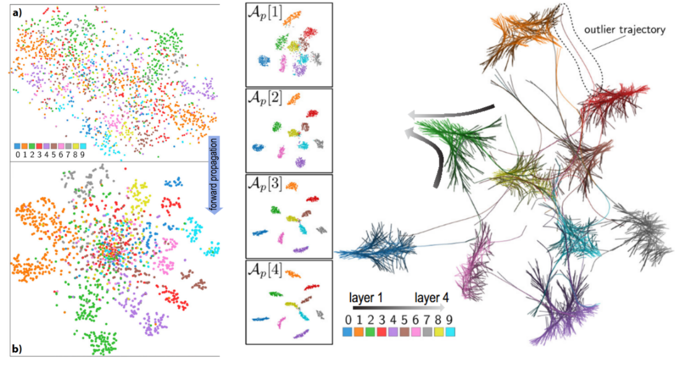

# DS5343 – Visualización de Datos
## Assignment: Visual Learning Models

**Institution:** UTEC – Universidad de Ingeniería y Tecnología  
**Instructor:** Germain Garcia-Zanabria  
**Date:** 3 de noviembre de 2026

---

## 1. Goal

Design a visualization that uncovers **how a neural network model learns**. The focus must be on a clear representation of a neural network model's **epochs** and **layers** evolution through the training process. The visualization must be accompanied by **animation resources** using the visualization mantra.

You may use the relationships between:
- Alternative, high-dimensional representations of observations learned by ANNs.
- Relationships between artificial neurons within a hidden layer.

In summary, you must build **two visualizations** to accomplish the following tasks:

- **T1:** Exploring the relationships between multidimensional projection of observations learned by ANNs — **considering different EPOCHS**.
- **T2:** Exploring the relationships between multidimensional projection of observations learned by ANNs — **considering different LAYERS**.

Use **Figure 1** as inspiration. These visualizations were presented as part of a paper in the paper/ folder.

> *Figure 1: Training Evolution, inter-layer and inter-epochs*
---

## 2. Data

Use a dataset suitable for pattern classification. You may use the same dataset used in the example paper:

- **MNIST** (handwritten digits)
- **SVHN** (house number digits)
- **CIFAR-10** (object photographs)

These datasets consist of observations (images as high-dimensional vectors) paired with target class assignments. You will need to:

1. Train an ANN model on your chosen dataset.
2. Extract the high-dimensional activations from its hidden layers for a subset of observations (e.g., 1000 test observations). These activations serve as the "learned representations" of the input data at a specific layer.

---

## 3. Assignment

Implement and apply the visualization techniques, focusing on **Tasks T1 and T2**.

### Steps

1. **Choose a dataset** from the list above (or a similar image classification dataset).
2. **Train an ANN model** on your chosen dataset.
3. **Extract hidden layer activations** for a subset of observations (e.g., from the test set) **before, during, and after training**.
4. **Consider extracting activations from different layers** to explore inter-layer differences.
5. **Apply a dimensionality reduction technique**, such as t-SNE, to the extracted hidden layer activations to project them into a 2D space. *(The paper used a variation of t-SNE.)*
6. **Create scatterplots** of the 2D projections. Color the points according to their **true class assignments**.
7. **Explore projections** from different layers or training stages (e.g., before and after training).
8. **Implement a method to visualize the evolution** of learned representations across layers (inter-layer) or across training epochs (inter-epoch). *(The paper uses trail bundling for inter-layer evolution visualization.)*

---

## 4. Evaluation Criteria

This assignment is worth **20 points**. Both the strength of your design and the quality of your computing process will be evaluated. Factors such as target audience, clarity of message, and how well the intended task is addressed will also be considered.

| Criterion | Description |
|---|---|
| **Clarity** | Is the visualization easy to interpret? |
| **Design Rationale** | Are your choices well-motivated? |
| **Tasks** | Does the visualization help answer the tasks effectively? |
| **Interaction** | Mandatory use of interaction and animation resources (e.g., `mouseenter`, `mouseover`, `mouseclick`, etc.). |
| **Number of datasets** | Using more than one dataset will positively impact your final grade. |
| **Projection effectiveness** | Assessed qualitatively by visual inspection (e.g., clarity of clusters, separation). |

---

## 5. Deliverables Instructions

- Your coded solutions **must use D3**. Other visualization libraries are **not allowed**.
- Submit to Canvas a **single ZIP** containing:
  - A **Flask application**
  - **Data files** (nodes and edges)
- You are required to **present your work in class**. Failure to present will result in **no grade** for this assignment.

---

## 6. AI Support

**AI support is allowed** in this assignment.